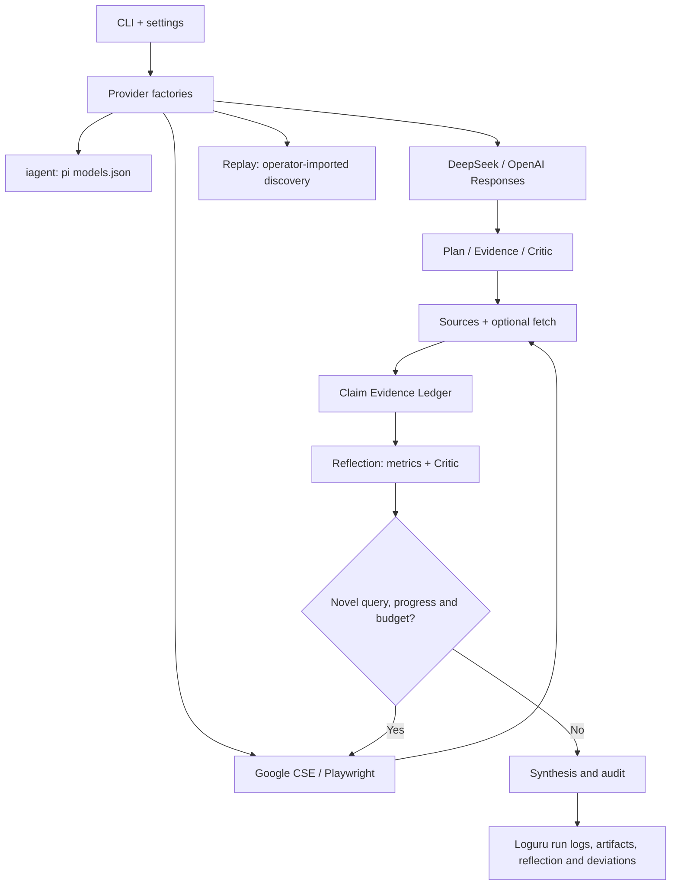

# Deep Search Factory Mode

Evidence-first deep research, implemented with a CleanRL-inspired **explicit algorithm script** and small **provider factories**. This branch began from an empty file tree; its initial empty-tree commit still has main as a parent, so Git history is not orphaned.

[中文](README.zh.md) | [Reflection Loop](docs/REFLECTION.md) | [Architecture](docs/ARCHITECTURE.md) | [API](docs/API.md) | [Master prompt](prompts/master.md) | [Offline evals](evals/README.md) | [Logging](docs/LOGGING.md) | [Case study](docs/CASE-EMBODIED-INTELLIGENCE.md) | [Skill](SKILL.md)

## Running

Requires Python 3.10+ and `loguru` (installed with the package).

~~~bash
python -m pip install -e .
python -m unittest discover -s tests -v
python benchmarks/offline_eval.py --out runs/evals
python algorithms/deep_research.py --question "Synthetic library opening" --provider mock --llm mock --fixture examples/offline_fixture.json --out runs/demo
~~~

Every run writes `logs/run.log`, `logs/run.jsonl` and `logs/errors.log` under its
output directory through a secret-redacting loguru setup; see
[docs/LOGGING.md](docs/LOGGING.md).

For a one-request-per-provider connectivity check, run `python scripts/live_smoke.py --live` after supplying credentials (this is not an accuracy test). `python scripts/probe_model.py --live` reports configuration *and* observed request behaviour for a pi-config provider.

For a live DeepSeek+Google run, provide `DEEPSEEK_API_KEY`, `GOOGLE_API_KEY` and `GOOGLE_CSE_ID`. To use OpenAI set `OPENAI_API_KEY` and optionally `OPENAI_MODEL` (default `gpt-6`; API access varies by account). The OpenAI adapter calls the **Responses API** rather than replaying DeepSeek's request protocol. Browser search is a separate optional Playwright provider; no Google API key is required for that provider.

A fourth, non-networked provider (added 2026-11-13) replays an **operator-imported** discovery list of real URLs: `--provider replay --search-fixture <file>` with a mandatory `provenance` block. It exists because browser/API search can be unavailable or degraded on a given host; the run manifest records `discovery_mode=operator_imported` so a reader never mistakes it for an automated search API. Lists marked `synthetic=true` are refused.

~~~bash
python algorithms/deep_research.py --question "Research topic" --provider google --llm deepseek --fetch-pages --out runs/live
python algorithms/strict_research.py --question "Research topic" --provider google --llm deepseek --fetch-pages --out runs/strict

# Optional browser provider (install Chromium once)
pip install -e '.[browser]'
python -m playwright install chromium
python algorithms/deep_research.py --question "Research topic" --provider playwright --browser-engine bing --llm openai --fetch-pages --out runs/openai-browser

# Pi-agent-configured model (provider resolved from ~/.pi/agent/models.json)
python algorithms/deep_research.py --question "Research topic" --llm iagent --provider playwright --fetch-pages --out runs/iagent-browser

# Worked example: 具身智能（人形机器人）产业链调查 (see docs/CASE-EMBODIED-INTELLIGENCE.md)
python algorithms/strict_research.py --config configs/cases/embodied-intelligence-chain.json \
  --question "具身智能产业链调查" --out runs/embodied-ai-chain-20261113

# Reflection controller options
python algorithms/deep_research.py --question "Research topic" --provider google --llm deepseek --reflection-patience 2 --reflection-similarity-threshold 0.92 --out runs/reflection
~~~

## Design

Each run writes real attempt logs, capabilities, sources, claims, critique, **reflection.json with deterministic stop reasons**, report, audit, a sanitized config, `logs/run.jsonl` and `logs/run.log`. Offline fixtures are synthetic, not proof of real events. Full-text quote matching is a structural check; it does not certify factual entailment.

**Known limits:** Browser search can be blocked by search engines and must respect applicable terms; Playwright is never used to bypass CAPTCHA. Observed on 2026-11-13: from a datacenter IP, Bing may answer CJK queries with dictionary/advertisement pages and DuckDuckGo may be unreachable — such degradation is logged and reported, never patched around. Model/search API integration is not verified by offline CI. Google Custom Search JSON API is unavailable to new customers and existing customers must transition by 2027-01-01. The optional HTML fetcher is not DNS-IP-pinned and must not be hosted as a public arbitrary-URL service. Live API integration is not verified by offline CI.

### References

- https://github.com/1998x-stack/deep-search (main's evidence model)
- https://github.com/AdamFangKK/deep-search (routing / strict execution concept)
- https://docs.cleanrl.dev/ (readable experiments)
- https://api-docs.deepseek.com/quick_start/pricing/
- https://developers.google.com/custom-search/v1/overview

## Review hardening (2026-11-13)

A successful structural citation check is **not** equivalent to a complete
research run. Starting with the current review, all modes require:

- At least one claim with status-appropriate quotation evidence anchored to
  retrieved full-text source material.
- A citation to an anchored claim source in the **report body** (a bibliography
  citation alone does not qualify).

If these conditions do not hold, the run writes its draft/limitations but
finishes with `status=incomplete` and a detailed `audit.json.readiness` record.
This is still NOT a factual correctness or source independence certification.

Use `--max-context-chars 48000` to cap serialized LLM inputs before API
requests; exceeding this hard bound is an explicit failure rather than an
unbounded request. Source excerpts are truncated under the shared budget and
marked `excerpt_truncated`, with newest sources considered first; a model
context excerpt must not be described as a complete document.

The direct Python API `ResearchConfig(question="...", llm="openai")` now
chooses the same OpenAI model/endpoint defaults as the CLI. See
[review record](docs/REVIEW-2026-11-13.md).

