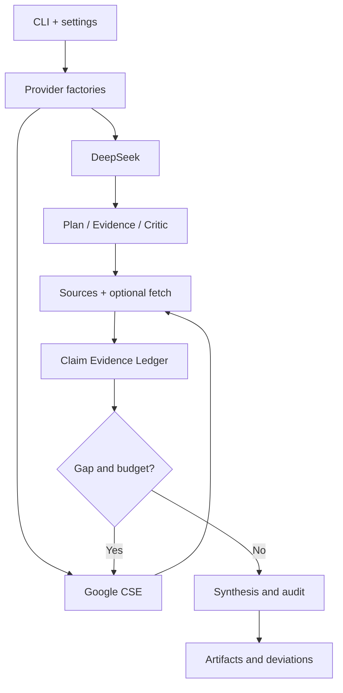

# Deep Search Factory Mode

Evidence-first deep research, implemented with a CleanRL-inspired **explicit algorithm script** and small **provider factories**. This branch began from an empty file tree; its initial empty-tree commit still has main as a parent, so Git history is not orphaned.

[中文](README.zh.md) | [Architecture](docs/ARCHITECTURE.md) | [API](docs/API.md) | [Master prompt](prompts/master.md) | [Offline evals](evals/README.md) | [Skill](SKILL.md)

## Running

Requires Python 3.10+. No required third-party packages.

~~~bash
python -m pip install -e .
python -m unittest discover -s tests -v
python benchmarks/offline_eval.py --out runs/evals
python algorithms/deep_research.py --question "Synthetic library opening" --provider mock --llm mock --fixture examples/offline_fixture.json --out runs/demo
~~~

For a one-request-per-provider connectivity check, run `python scripts/live_smoke.py --live` after supplying credentials (this is not an accuracy test).

For live use provide `DEEPSEEK_API_KEY`, `GOOGLE_API_KEY` and `GOOGLE_CSE_ID` in the execution environment. Model defaults to `deepseek-flash` (DeepSeek V4.1 Flash 1017).

~~~bash
python algorithms/deep_research.py --question "Research topic" --provider google --llm deepseek --fetch-pages --out runs/live
python algorithms/strict_research.py --question "Research topic" --provider google --llm deepseek --fetch-pages --out runs/strict
~~~

## Design

Each run writes real attempt logs, capabilities, sources, claims, critique, report, audit and a sanitized config. Offline fixtures are synthetic, not proof of real events. Full-text quote matching is a structural check; it does not certify factual entailment.

**Known limits:** Google Custom Search JSON API is unavailable to new customers and existing customers must transition by 2027-01-01. The optional HTML fetcher is not DNS-IP-pinned and must not be hosted as a public arbitrary-URL service. Live API integration is not verified by offline CI.

### References

- https://github.com/1998x-stack/deep-search (main's evidence model)
- https://github.com/AdamFangKK/deep-search (routing / strict execution concept)
- https://docs.cleanrl.dev/ (readable experiments)
- https://api-docs.deepseek.com/quick_start/pricing/
- https://developers.google.com/custom-search/v1/overview

