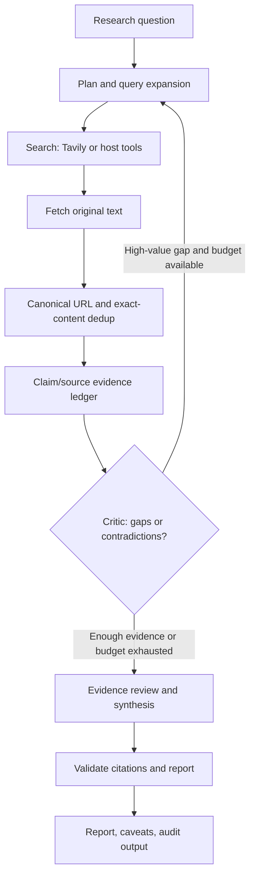

# Deep Search

**Evidence-first, auditable deep research for Codex, Claude Code, OpenCode and Python.**

[简体中文](README.zh.md) · [Architecture](docs/ARCHITECTURE.md) · [Skill](SKILL.md) · [Methodology](references/research-methodology.md)

> Research software must distinguish retrieving a quotation from verifying the claim it allegedly supports.

## Why this project exists

Typical search assistants conflate search-result snippets, copied articles and independent sources. This project separates **research reasoning** (the host agent), **retrieval** (optional search/fetch integrations), **claim provenance** (structured ledger), and **deterministic audit** (Python CLI). It does not assert that a successful audit means the report is true.

## Pipeline



## Install

Requires Python **3.10+**. No mandatory third-party packages.

```bash
git clone https://github.com/1998x-stack/deep-search.git
cd deep-search
python -m pip install -e .
deep-search --help
```

The repository also exposes `python -m deep_search` and `scripts/*.py` wrappers. CLI search is optional: agents can use other web tools while maintaining the same evidence ledger.

## Quick start — offline / no API key

```bash
deep-search plan --question "What evidence supports a policy claim?" --output runs/plan.json
deep-search validate --input examples/demo-ledger.json
deep-search report --plan examples/demo-plan.json \
  --ledger examples/demo-ledger.json --output runs/demo-report.md
deep-search audit --report runs/demo-report.md \
  --ledger examples/demo-ledger.json --output runs/audit.json
```

The demo is **synthetic**, for structure testing, and makes no claim about real events.

## Optional live retrieval

Set `TAVILY_API_KEY` in your shell or secret manager; do not commit API keys.

```bash
export TAVILY_API_KEY="your-key"
deep-search search --input runs/plan.json --output runs/search.json
deep-search fetch --input runs/search.json --output runs/fetched.json --allow-network
deep-search dedup --input runs/fetched.json --output runs/unique.json
```

The CLI does **not** invent findings or automatically synthesize validated claims. A researcher must inspect source text, populate a ledger matching [the evidence contract](schemas/evidence.schema.json), assess independence, then write the final interpretation. `report` produces an evidence inventory rather than an autonomous long-form essay.

**Security:** `fetch` rejects private/non-public IP ranges, credential URLs, uncommon ports and excessive redirects, but DNS validation is not IP-pinned. Do **not** expose it as a public arbitrary-URL fetch service. Network operations are never required for offline tests.

## Features and limits

| Component | Implemented | Important limitation |
| --- | --- | --- |
| Research plan | Deterministic, budgeted starter queries | Needs agent review and multilingual expansion |
| Search | Tavily REST adapter | Requires key/network; no embedded search index |
| Fetch | Bounded HTML/text retrieval | Not an SSRF-proof production fetcher; excludes PDF |
| Dedup | URL normalization and exact-content fingerprint | Cannot determine independent authorship |
| Evidence ledger | Source/claim IDs, quoted passages, polarity | Human/agent must judge entailment |
| Validate | Quote presence and ID integrity | Passing does not prove factual correctness |
| Report | Traceable evidence inventory | Narrative synthesis is agent-authored |
| Audit | Detects dangling references and incomplete claims | Does not check online URL status |
| Tests | Offline unit suite + GitHub CI | Real-search integration tests require credentials |

## Agent installation

| Host | Repository skill directory |
| --- | --- |
| Codex | `.agents/skills/deep-search/SKILL.md` |
| Claude Code | `.claude/skills/deep-search/SKILL.md` |
| OpenCode | `.opencode/skills/deep-search/SKILL.md` |

All three copies are generated from the same canonical `SKILL.md`; CI fails if they drift. Use at repository root; included prompts and references are repository-root-relative.

## Quality model

Research quality is assessed through **claim coverage**, **citation validity**, **quotation provenance**, **contradiction handling**, **source independence**, **time relevance** and **transparent uncertainty**. Fixed counts of sources are diagnostic—not a substitute for evidence quality. See [evaluation rubrics](evals/README.md).

## References and provenance

The project design was informed by the [Agent Skills open specification](https://agentskills.io/specification), [OpenAI Codex skills](https://learn.chatgpt.com/docs/build-skills), [Claude skills](https://platform.claude.com/docs/en/agents-and-tools/agent-skills/overview), [OpenCode skills](https://opencode.ai/docs/skills), [LangChain deep research prompt](https://github.com/langchain-ai/deepagents-quickstarts/blob/main/deep_research/research_agent/prompts.py), [Stanford STORM](https://github.com/stanford-oval/storm), [Tavily API examples](https://github.com/tavily-ai/skills) and [research citation evaluation](https://arxiv.org/abs/2605.06635). Original implementation; no upstream code is copied.

## Development

```bash
python -m unittest discover -s tests -v
python -m compileall -q deep_search scripts tests
```

See [AGENTS.md](AGENTS.md) for contributor safeguards, [architecture](docs/ARCHITECTURE.md) for design tradeoffs, and [LICENSE](LICENSE) (MIT).

