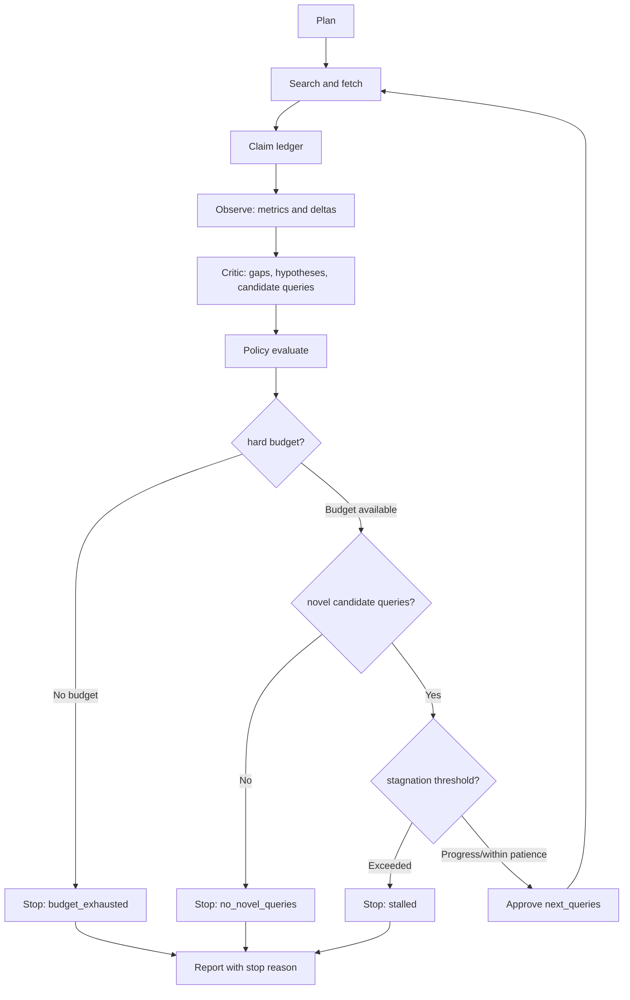

# v0.3 Architecture — OpenAI, Playwright and Autonomous Reflection

Status: engineering design, implemented incrementally and tested offline. Base: `factory/cleanrl-deepseek-google-v1`; production `main` is unchanged.

## Code categories

| Concern | Code | Contract |
| --- | --- | --- |
| Model provider | `factory/models.py` | `ask(stage, system, user, json_mode)` shared by DeepSeek/OpenAI/Mock |
| Browser search | `factory/playwright_search.py` | `search(query,num) -> source candidates`; optional Playwright install |
| Search factory | `factory/search.py` | `google`, `playwright`, `mock` |
| Reflection | `factory/reflection.py` | pure metrics, duplicate query filter, progress state, policy decision |
| Orchestration | `factory/pipeline.py` | explicit steps, guaranteed hard caps, per-round reflection artifact |
| Configuration | `factory/config.py`, `configs/*.json` | provider-specific URL/model, iteration thresholds, browser selectors |
| CLI | `algorithms/deep_research.py` | flags for providers and reflection policy |
| Tests | `tests/test_openai.py`, `test_playwright.py`, `test_reflection.py` | HTTP and browser mocks, no paid API |
| Docs | `docs/API.md`, `docs/REFLECTION.md` | intent, policy, reproducibility |

## OpenAI provider

Use `POST https://api.openai.com/v1/responses` and `OPENAI_API_KEY`. The default model is configurable via `OPENAI_MODEL` (default `gpt-6`; account access is not assumed). JSON stages request `text.format.type=json_object`, still require explicit JSON instructions, then parse completed `output[].content[].text` where `type=output_text`. Do not assume the Chat Completions response structure or blindly log request errors containing tokens. `store=false`; bounded output and retries. Separate model base URL from DeepSeek URL.

## Playwright discovery

Use the optional `playwright` Python package and installed Chromium. Search through a **fixed** publicly accessible search result page, initially Bing `https://www.bing.com/search`, by visiting a URL built from URL-encoded query parameters. Parse result containers with locators (`li.b_algo`, `h2 a`, snippet text); expose source metadata only. The result page is a discovery surface, **not** an evidence source. No login, CAPTCHA solving, stealth plugins, proxy rotation or access restriction bypass. Respect site terms and rate limits. Use a short-lived isolated browser context and close it even when errors happen. Never execute arbitrary JavaScript from search content. Strict result caps and no credential storage.

Playwright is not a Google API replacement with guaranteed coverage. Search pages change layout and may block automated browsing; fail openly and retain previous search provider compatibility.

## Reflection Loop formal contract

Each round computes:
- `sources_total`, `new_sources`, `full_text_sources`;
- `anchored_support_claims`, `unverified_claims`, `disputed_claims`;
- `progress_delta` = newly anchored support OR newly fetched full text; source count is logged separately because links/snippets do not establish material progress.
- `consecutive_stalled_rounds` (never trust model-declared progress alone);
- `query_novelty` against all attempted and pending queries (normalized case/whitespace and fuzzy similarity);
- `remaining_queries`, `remaining_rounds` and `remaining_source_capacity`;
- `critic.stop` and `critic.next_queries` are **proposals**, not unconditional authority.

Stopping order:
1. User/critic explicit stop with a meaningful explanation.
2. Budget hard stops (`max_rounds`, `max_queries`, `max_sources`).
3. No new valid/novel queries.
4. Stagnation after `reflection_patience` consecutive no-progress rounds.
5. Otherwise continue with at most the remaining query budget.

`reflection.json` stores per-round metrics, proposal, approved query list, decision, stop reason, and policy version; `run.json` contains final stop reason. There is no claim of calibrated confidence score. This state machine is deterministic for identical state and proposal.

## Backwards compatibility

Retain existing DeepSeek+Google/mock CLI and their offline tests. Preserve the JSON artifact layout and existing Strict Mode semantics. Browser provider is optional; absent dependency is reported as an installation requirement, not silently replaced with fake search. Never commit API tokens.

## Source documentation

- OpenAI Responses API: https://developers.openai.com/api/reference/resources/responses/methods/create
- OpenAI structured text: https://developers.openai.com/api/docs/guides/structured-outputs
- Playwright Python: https://playwright.dev/python/docs/api/class-page
- Playwright isolated context: https://playwright.dev/python/docs/api/class-browsercontext

