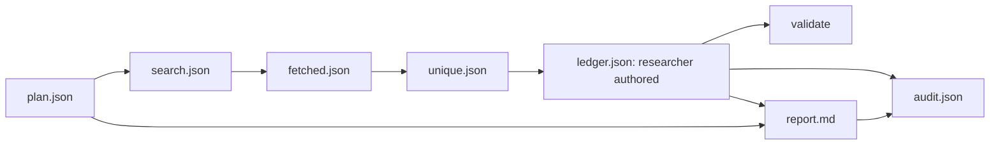

# Architecture and engineering decisions

## 1. Scope

Two cooperating layers: an **agent-facing skill** (non-deterministic question selection, adversarial reading, synthesis) and a **reproducible CLI** (query budget enforcement, bounded fetch, deduplication, provenance integrity, report-reference checks). This is not a continuously autonomous deep research platform.

## 2. Data flow and artifacts

### Contracts

- `research-plan.schema.json`: question, subquestions, concrete query strings and bounded budgets.
- `evidence.schema.json`: sources with original text and claims with supporting/contradicting quotes.
- `report.schema.json`: optional machine-readable metadata contract; rendered report is Markdown.
- Exit 0 = operation/quality gate passed; exit 1 = incomplete retrieval or failed evidence gate; exit 2 = invalid command or input.

## 3. Failure modes addressed

| Failure mode | Control | Residual risk |
| --- | --- | --- |
| Search confirmation bias | counterevidence avenue in plan + Critic | heuristic plan does not discover every hypothesis |
| Source proliferation | canonical URLs / identical content dedup | rewrites, ownership, syndication need human review |
| Unsupported citation | source IDs, quotes matched to retrieved content | context can reverse a quote's meaning |
| Broken citations | deterministic report-reference audit | links may go stale between runs |
| Hallucinated search | missing key causes explicit failure | provider ranking can omit key pages |
| Too much searching | query/results/fetch limits | agent may under-research |
| SSRF | public IP check, redirect check, ports, byte/time caps | DNS rebinding / host resolution race remain |
| Prompt injection | research instructions treat sources as data | malicious content requires agent discipline |

## 4. Non-goals in v0.1

Semantic entailment, automatic report truth certification, PDF/OCR parsing, provider-agnostic retriever registry, persistent cross-run vector database, comprehensive license checks, browser rendering, paywall bypass, and fully autonomous iterative LLM orchestration.

## 5. Why not a giant prompt?

A single prompt cannot establish reproducibility of search outputs, URL validity or claim-to-quote integrity. Conversely, rule-based scripts cannot reason about political/legal/technical meaning. The boundary is explicit so both layers can be independently tested.

## 6. Extension points

Define a search adapter returning standardized `source` records; add ingestion adapters for PDF/public datasets; introduce source-content snapshots with SHA-256 and versioning; support contradiction graph edges and human reviewer decisions; evaluate the resulting changes on independent labeled sets.

## 7. Upstream reading

- Agent Skills specification: https://agentskills.io/specification
- LangChain deep research: https://github.com/langchain-ai/deepagents-quickstarts
- Stanford STORM: https://github.com/stanford-oval/storm
- OpenCode skills: https://opencode.ai/docs/skills
- Citation evaluation: https://arxiv.org/abs/2605.06635

