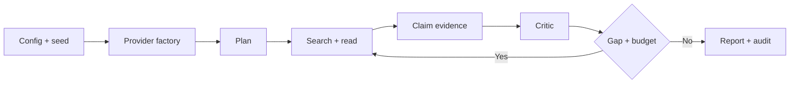

# Factory Mode architecture and code categories

| Layer | Files | Responsibility |
| --- | --- | --- |
| Config | factory/config.py, configs/*.json | limits, seeds, runtime parameters |
| Model factory | factory/models.py | DeepSeek chat completions / mock |
| Search factory | factory/search.py | Google Custom Search JSON API / mock |
| Fetch | factory/fetch.py | opt-in, bounded public HTML retrieval |
| Evidence | factory/evidence.py | source provenance, dedup, quotation audit |
| Research | factory/prompts.py, factory/pipeline.py | planning, research, critique, reflection, synthesis |
| Entrypoints | algorithms/*.py | explicit CleanRL-style loops and CLI |
| QA | tests/, .github/workflows/ci.yml | deterministic tests without live billing |
| Runtime output | runs/ | plan, search, sources, ledger, report, audit, deviations |

## Workflow

## Design contracts

- Factory code only constructs clients. Research logic remains explicit and readable.
- Config is bounded: max rounds, queries, sources, fetches, timeouts, tokens and retries.
- DeepSeek `deepseek-flash` via OpenAI-compatible `/chat/completions`; use JSON output for structured stages.
- Google CSE GET with `key`, `cx`, `q` and bounded `num` 1–10.
- Save every stage artifact, deviations, failure details, and sanitized config; never secrets.
- Evidence status is `supported`, `partially_supported`, `disputed`, `unverified` or `refuted`.
- Claim quote must occur in the retrieved **full text** before structurally supporting a claim.
- Structural validity is NOT semantic correctness, independence, or proof of causation.
- Search snippets alone remain unverified.
- Zero network operations for offline CI; actual live API calls require injected secrets.

## Independent implementation

This code draws concepts, not copied upstream code, from previous main's Evidence First contract, AdamFangKK's query routing / capability / strict execution, and CleanRL's single-file readability, reproducibility and testing. No reinforcement learning algorithm is implemented.

## Google sunset and security

Google CSE existing users need to transition by January 1, 2027: https://developers.google.com/custom-search/v1/overview

Fetcher validates public destinations and byte caps but does not pin DNS-resolved IP at transport time. Do NOT use as a public SSRF-proof URL fetch service.

