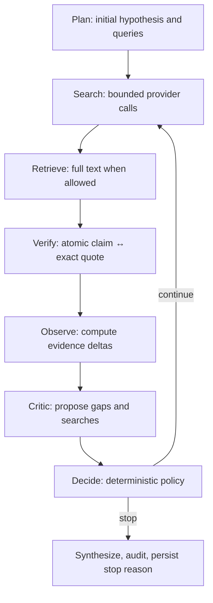

# Autonomous Reflection Loop — formal implementation contract

This describes actual running code in `factory/reflection.py` and `factory/pipeline.py`. It is a bounded autonomous decision policy, not free-running LLM introspection or a factual truth metric.

## Stage mapping



| Research idea | Actual code | Artifact |
| --- | --- | --- |
| Plan / hypotheses | `pipeline.run_research()` calls model planner | `plan.json` |
| Search and full-text | `create_search` + optional `fetch_text` | `search.json`, `sources.json` |
| Evidence | `normalize_claims` with exact quote matching | `ledger.json` |
| Observe | `reflection.observe()` | `reflection.json[].observation` |
| Critique | model `CRITIC` via `llm.ask("critic", ...)` | `critic.json` |
| Policy | `reflection.decide()`, `novel_queries()` | `reflection.json[].decision` |
| Synthesis | model + deterministic source index | `report.md` |
| Audit | `evidence.audit()` and strict gates | `audit.json`, `run.json` |

## Observation vector

- `sources_total` — count of unique canonical URLs/content identities, NOT independent sources.
- `new_sources` — discovery growth, **not** proof of research progress.
- `full_text_sources` / `new_full_text` — retrieved readable originals.
- `anchored_support_claims` / `new_anchored_support_claims` — exact full-text quote anchor, not semantic validity.
- `unverified_claims`, `disputed_claims` — unresolved knowledge limitations.
- `remaining_queries`, `remaining_rounds`, `remaining_source_slots` — hard budgets.
- `progressed` = new full text OR newly anchored supported claim. **New links/snippets alone do not reset stagnation.**

## Hybrid model/controller contract

Critic receives the current atomic claims, observed metrics, prior reflection and attempted query history. It must propose:
```json
{
  "stop": false,
  "next_queries": ["Find original amendment text", "Search dated counterevidence"],
  "gaps": ["Current effective-date scope not verified"],
  "contradictions": [],
  "rationale": "A dated primary source may change the conclusion"
}
```

This is a **proposal**, not a command. The deterministic controller validates the type of `stop` and `next_queries` and evaluates:

1. `critic_requested_stop` — Critic explicitly stops.
2. `round_budget_exhausted` — max rounds reached.
3. `query_budget_exhausted` — no query calls remain.
4. `source_budget_exhausted` — no slots remain for new findings.
5. `stagnated` — no new full text or anchored evidence for `reflection_patience` consecutive rounds.
6. `no_novel_queries` — candidates repeat (or closely resemble) already attempted searches.
7. `high_value_research_gap` — continue using only approved, budget-bounded novel candidates.

Important: "high_value_research_gap" is the **reason for continued exploration**, not a statistically measured information gain. Fuzzy similarity uses character `SequenceMatcher` rather than semantic embeddings; multilingual synonyms can still repeat meaning.

## Convergence and stop conditions

The controller is pure and deterministic for identical observations, proposed queries, and configuration. `max_rounds`, `max_queries`, `max_sources`, `max_fetch`, timeouts, retries and token caps bound resources; no unbounded inner self-reflection loop exists.

A stopped run can still be `incomplete` if Strict Mode rejects unsupported claims or citations. `completed` means the structural audit passed, not that the research findings are true.

## Artifacts and reproducibility

For every round, `reflection.json` contains:
- `round`;
- `observation` (measured metrics);
- `proposal` (model output, including gaps);
- `decision`: `action`, `reason`, `next_queries`, `stalled_rounds`, `policy_version`.

The final `run.json.stop_reason` stores the terminal reason; `deviations.json` stores tool errors. Output is overwritten on reruns, not blended with previous reports. Source and browser failures are never silently replaced with simulated outputs.

## Known limitations and next evaluations

- No calibrated probabilistic confidence score, causal inference, or evidence independence checker.
- No semantic-equivalence search embedding model yet.
- Source-content injection remains an LLM risk: page content is treated as data, not instructions.
- A verified exact string is still not verified factual entailment; a human/agent reviewer must check context.
- Future evaluation: labeled topics measuring source recall, contradiction discovery, independent-origin coverage, answer correctness, and research cost in live authorized runs.


## Additional final research readiness gate (2026-11-13)

Reflection stopping conditions control how many searches to perform; **they
do not make the final answer complete**. After synthesis and structural
citation checking, `assess_research_readiness()` checks grounded claims and
report-body citations in **every** mode. An empty ledger, snippet-only claims
or a citation visible only in the bibliography yields `incomplete` even if
Critic requested a stop or research budgets were exhausted.

This distinction prevents the loop's stop decision from being conflated
with a factual-quality or source-coverage assurance. See the code audit
record and tests.
